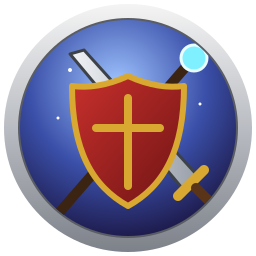

# HoMM4Recomp

## 👉 [**Open the converter: gamerecomp.github.io/HoMM4Recomp**](https://gamerecomp.github.io/HoMM4Recomp/) 👈

**Turn your own copy of *Heroes of Might and Magic IV* (with *The Gathering Storm* and *Winds of War*) into a native
build for Windows, Linux or Android, or play it right in your browser.** Everything happens on your machine: your
installer is not uploaded anywhere.

HoMM4Recomp is an unofficial project that rebuilds the game as a native program for today's systems, from your own
copy: no emulator, no Wine. The game's own code is translated ahead of time ("static recompilation") and runs on a
small replacement for the parts of Windows and DirectX it uses, on top of SDL3. It is the third project on the
toolchain of [TropicoRecomp](https://github.com/GameRecomp/TropicoRecomp) and
[CulturesRecomp](https://github.com/GameRecomp/CulturesRecomp).

> Unofficial fan project. Not affiliated with Ubisoft, 3DO, New World Computing or GOG.
> This repository contains **no game code and no game data**, and it never will: you bring the game.

## What you need

The German GOG installer of *Heroes of Might and Magic IV – Complete*: both files,
`setup_heroes_of_might_and_magic_4_complete_3.0_(german)_(25023).exe` and its `-1.bin`. Other languages are added
once their installers are known (by their checksums).

## How to play

1. Open the **[converter](https://gamerecomp.github.io/HoMM4Recomp/)** in a desktop browser (or build the page
   yourself with `tools/build-web`).
2. Choose **both** installer files at once. They stay on your computer.
3. Choose your system: Windows (zip), Linux (AppImage), Android (APK), or **Browser** to play right there.

Without a browser: `recomp convert --system linux setup_heroes_of_might_and_magic_4_complete_3.0_(german)_(25023).exe`
(the `.bin` beside it) writes `Heroes4-linux.zip`.

The build contains your copy of the game: keep it for yourself and do not share it.

## State

The game runs: intro, menus, scenarios with the adventure map, towns, battles and the computer players' turns,
saving and loading, network games between two copies, and the campaign editor. It is young software: nothing has been
played through to the end yet. See [docs/RELEASE-NOTES.md](docs/RELEASE-NOTES.md) for the known issues and
[docs/PLAN.md](docs/PLAN.md) for the plan.

## For developers

How it works and how to build it: [docs/DEVELOPMENT.md](docs/DEVELOPMENT.md).

## License

[MIT](LICENSE) applies to the code in this repository. The game itself is the property of its rights holders. Buy it
(for example on GOG) to use this project.
